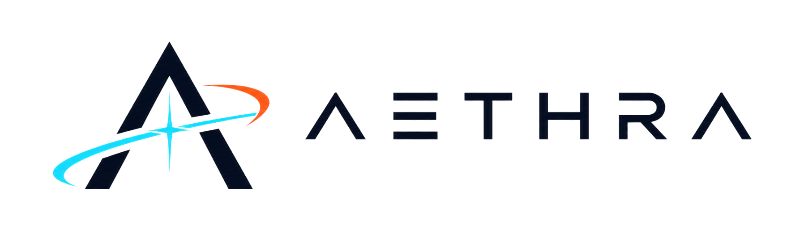
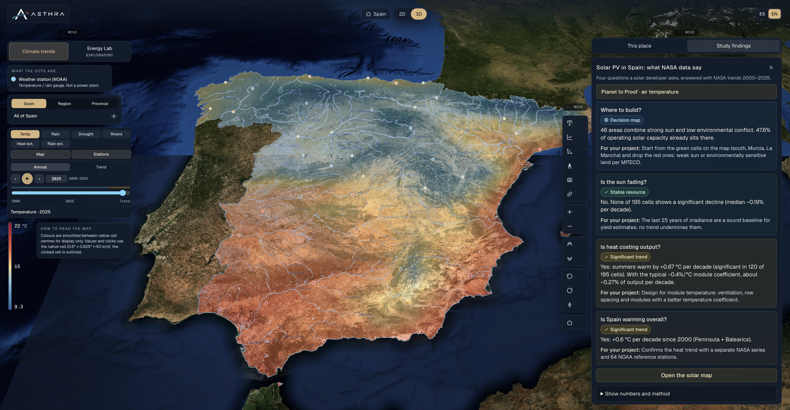
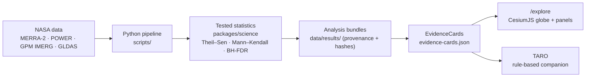

<div align="center">

<picture>
  <source media="(prefers-color-scheme: dark)" srcset="presentation/AETHRA_Logo_Kit/PNG/03_Full_Color_Transparent.png">
  
</picture>

### Earth evidence, not answers you want.

**NASA Earth data for Spain, turned into trends you can defend.**

[](https://github.com/RaulMermans/AETHRA/actions/workflows/ci.yml)
[](LICENSE)


[**Live app**](https://nasa-project-spain.vercel.app/explore) ·
[**30 s videos**](docs/release/2026-11-15/video/) ·
[**Pitch deck**](presentation/) ·
[**Submission text**](docs/SUBMISSION_PACKAGE.md) ·
[**Judge demo path**](docs/JUDGE_EXPERIENCE.md)

</div>

<p align="center">
  
</p>

> [!IMPORTANT]
> All results are **EXPLORATORY until independent scientific review**
> ([SCIENTIFIC_REVIEW.md](docs/SCIENTIFIC_REVIEW.md) §5). AETHRA does not forecast, rank investment
> sites or estimate electricity production. When the data can't decide, it says **insufficient evidence**.

## 🌍 Background

AETHRA was built over one weekend at the **NASA International Space Apps Challenge 2026** local event
in Málaga (14–15 November 2026), for Challenge #02, *Be An Earth System Trend Detective!* The
challenge asks for a tool that takes NASA observations or models for a region, builds a time series
over a meaningful period, and says whether there is a trend, how large it is, and whether it is
statistically significant.

**Why Spain and why energy.** Spain is one of Europe's largest solar markets, and new plants
are being planned on land whose climate is itself changing. People hear two things: "the sun is
plentiful" and "the climate is warming". Few can say what the satellite and reanalysis record
actually supports for a specific place. We wanted a tool that answers that honestly, including when
the answer is *we can't tell*.

**What we chose not to build.** Climate dashboards that colour every map red and AI tools that sound
sure of anything are easy to make. We decided early that AETHRA would be **evidence-first**:

- every number comes from tested Python, not from the browser or a language model;
- the regions, thresholds and verdict rules were written down before we looked at results;
- every finding is an **EvidenceCard** that shows its source, method, uncertainty and limits;
- "no robust trend" and "insufficient evidence" are shown as real answers, not hidden.

**How the weekend went.**

| When | What happened |
|---|---|
| Sat morning | Repo created; NOAA station data and a catalogue of 1,084 NASA Earthdata collections gathered for Spain |
| Sat afternoon | NASA MERRA-2, GLDAS, SWOT and MODIS subsets downloaded; first 3D globe with CesiumJS |
| Sat night | Statistics pipeline hardened (Theil–Sen, Mann–Kendall, FDR correction); first full evidence chain for air temperature, checked against 64 NOAA stations |
| Sun morning | Judge mode, Spanish/English interface, TARO companion, solar PV screening use case |
| Sun afternoon | Seville PV case study, accessibility mode, pitch deck, captioned 30 s videos, CI |
| Sun evening | Final release validation and submission |

The full reasoning behind each choice is logged in [DECISIONS.md](docs/DECISIONS.md) (D1–D87).

## 🔭 The question

A solar developer asks: **where in Spain should we look first for the next solar farm, and are the
conditions those plants depend on changing?**

AETHRA answers with NASA data and says how strong the evidence is. Every answer is an
**EvidenceCard**: variable, units, region, period, slope with its 95 % interval, test, NASA source and a
"do not conclude" line.

## 📊 What NASA's evidence says

| Question | Answer | Evidence |
|---|---|---|
| **Where to look first?** | 46 of 246 grid cells combine strong sun with mostly low/moderate environmental sensitivity (MITECO); 79 are *avoid*. 47.6 % of registered operating solar capacity already sits in the *look here first* cells | [`pv-screening.json`](apps/web/public/data/pv-screening.json), rule `pv-screening/v1` fixed before results |
| **Is the sun fading?** | **No robust trend.** None of the 195 cells tested shows a supported irradiance trend after FDR correction (2000–2025) | NASA MERRA-2 SWGDN |
| **Are summers warming?** | **Supported increase** in 120 of 195 cells (median +0.67 °C per decade) | NASA MERRA-2 T2M, June–August |
| **Is Spain warming?** | **+0.60 °C per decade** (95 % CI 0.31–0.87), Peninsula + Balearics, 2000–2025; all 64 long-record NOAA stations compared show a positive trend | [`gate_a_temperature`](data/results/gate_a_temperature/analysis_bundle.json), [`noaa_validation`](data/results/noaa_validation/analysis_bundle.json) |
| **Are low-sun + low-wind days more common?** | **Insufficient evidence** in all five pre-registered regions (Peninsula + Balearics: 0.0 days per decade, 95 % CI −1.8 to +2.2) | [`energy_gap`](data/results/energy_gap/analysis_bundle.json), NASA POWER |

**Case study, east of Seville (cell `r20c20`, chosen after seeing the map).** Sunshine in the 87th
percentile of Spain, 84 % of the land rated low or moderate sensitivity, 64 operating PV phases in the
register. Four NASA POWER tests pre-registered for 2001–2025 (sunlight, summer heat, hot days, aerosol):
**no robust trend** in any of them. → [docs/PV_SEVILLA_CASE.md](docs/PV_SEVILLA_CASE.md)

## ⚙️ How it works



- **The browser never computes statistics.** It renders numbers exported by tested Python.
- **Honest outcome states:** *Supported increase/decrease*, *No robust trend detected*, *Insufficient
  evidence*. A null result is a result.
- **Pre-registration:** regions, thresholds and verdict rules are written in `docs/` before results are
  computed; decisions are logged in [DECISIONS.md](docs/DECISIONS.md).
- **TARO**, the in-app companion, is rule-based (no LLM in the judge build). It quotes EvidenceCards and
  precomputed regional statistics; regional rain and runoff figures are labelled EXPLORATORY (D86).
- **Accessible:** captions and transcripts for every video, colour-blind palettes, a text "map in
  words" mode ([ACCESSIBILITY.md](docs/ACCESSIBILITY.md)).

## 🛰️ Data

| Product | Role |
|---|---|
| NASA MERRA-2 M2TMNXSLV v5.12.4, T2M ([10.5067/AP1B0BA5PD2K](https://doi.org/10.5067/AP1B0BA5PD2K)) | Air temperature trends |
| NASA MERRA-2 M2TMNXRAD v5.12.4, SWGDN ([10.5067/OU3HJDS973O0](https://doi.org/10.5067/OU3HJDS973O0)) | Solar resource per grid cell |
| NASA POWER daily v2.10.3 (CERES SYN1deg solar, MERRA-2 wind and temperature) | Daily solar/wind resource, Seville case |
| NASA GPM IMERG Final V07 ([10.5067/GPM/IMERG/3B-MONTH/07](https://doi.org/10.5067/GPM/IMERG/3B-MONTH/07)) | Rain context maps (EXPLORATORY) |
| NASA GLDAS Noah v2.1 ([10.5067/SXAVCZFAQLNO](https://doi.org/10.5067/SXAVCZFAQLNO)) | Modelled runoff context (EXPLORATORY) |
| NOAA GHCN-Daily | Station comparison for MERRA-2 temperature |
| MITECO PV zoning 2024 · GEM Global Solar Power Tracker (CC BY 4.0) · Eurostat GISCO NUTS 2021 | Environmental sensitivity, plant register, boundaries |

Full inventory and provenance: [DATASETS.md](docs/DATASETS.md). Globe imagery credits (NASA GIBS, EOX
Sentinel-2 cloudless, Esri, Cesium) are shown in the app.

## 🚀 Run it

```bash
cd apps/web
npm ci
npm run dev        # → http://localhost:3000/explore (judge mode)
```

Node 20+ (22.6+ for the TARO policy test) and Python 3.11. No secrets are needed to run the app; only
data downloads need Earthdata credentials (see `.env.example`). The research build with the
exploratory Energy Lab is `NEXT_PUBLIC_ENABLE_EXPLORATORY=1 npm run dev` and is never used for judging.
Rebuilding data: [scripts/README.md](scripts/README.md).

## ✅ Verify

```bash
python3.11 -m venv .venv && .venv/bin/pip install -r requirements-test.txt
.venv/bin/python -m pytest -q packages/science tests   # statistics, evidence chain, demo safety, release guards, a11y
cd apps/web && npm run typecheck && npm run lint && npm run build
npm run e2e                                            # Playwright: simulated use cases
```

[CI](.github/workflows/ci.yml) runs pytest and the web typecheck, lint and judge build on every push and
PR. Two tests need gitignored raw data (`test_miteco_cvd_pngs_match_rasters`,
`test_numbers_reproducible_for_sample_cells`) and run locally only. Last full release validation:
[FINAL_RELEASE_VALIDATION.md](docs/FINAL_RELEASE_VALIDATION.md).

## 🗂️ Repository

```text
apps/web/          Next.js + TypeScript + CesiumJS globe, EvidenceCards, TARO
packages/science/  NumPy trend statistics (Theil–Sen, Mann–Kendall, Hamed–Rao, BH) + tests
scripts/           Data download, processing and export (every output records its provenance)
data/              Processed Spain subsets, analysis bundles (data/results), metadata
tests/             Evidence chain, demo safety, release guards, accessibility
docs/              Project, decisions, datasets, scientific review, submission
docs/release/      Screenshots, deck, captioned videos and validation runs (15 Nov 2026)
presentation/      HTML pitch deck and logo kit
experiments/taro/  TARO avatar experiments (not part of the app build)
services/api/      Placeholder, not used (results are served as static files)
```

Key docs: [PROJECT](docs/PROJECT.md) · [DECISIONS](docs/DECISIONS.md) · [DATASETS](docs/DATASETS.md) ·
[SCIENTIFIC_REVIEW](docs/SCIENTIFIC_REVIEW.md) · [UX_UI_RULES](docs/UX_UI_RULES.md) ·
[TEAM_WORKFLOW](docs/TEAM_WORKFLOW.md) · [AGENTS.md](AGENTS.md). Event material:
[docs/reference/event/](docs/reference/event/).

## 👥 Team

<table>
  <tr>
    <td align="center" valign="top" width="33%"><a href="https://github.com/RaulMermans"><br><b>Raúl Mermans</b></a><br><sub>@RaulMermans</sub><br><br><sub>Science pipeline and evidence chain, EvidenceCards and judge mode, globe and Earth layers, Spanish/English interface, release validation, CI and docs</sub></td>
    <td align="center" valign="top" width="33%"><a href="https://github.com/rorro6787"><br><b>Emilio Rodrigo Carreira Villalta</b></a><br><sub>@rorro6787</sub><br><br><sub>Project setup, NOAA and NASA dataset catalogue, administrative scoping (CCAA, provinces), Energy Lab, TARO companion, logo and pitch deck</sub></td>
    <td align="center" valign="top" width="33%"><a href="https://github.com/LinceAzul"><br><b>Ivan Iroslavov</b></a><br><sub>@LinceAzul</sub><br><br><sub>NOAA GHCN-Daily, GLDAS and MERRA-2 wind data for Spain, solar PV screening and Seville/Jaén cases, plain-language findings, accessibility mode</sub></td>
  </tr>
</table>

Built during NASA International Space Apps Challenge 2026, Málaga (14–15 Nov 2026). Roles above are
summarised from each person's commits. This repository is a copy of
[rorro6787/nasa-project-spain](https://github.com/rorro6787/nasa-project-spain), with its full commit
history and branches.

## 🤖 AI use

Code and documentation were written with an AI coding assistant (Anthropic Claude via Claude Code),
directed and reviewed by the team. Scientific definitions were fixed in `docs/` before results were
computed, and every number comes from tested Python, not from a model. The video voice-overs are
synthetic (Kokoro-82M TTS). Full disclosure: [SUBMISSION_PACKAGE.md](docs/SUBMISSION_PACKAGE.md) §4.

## 📄 License

GPL-3.0, see [LICENSE](LICENSE). Third-party data keep their own licences ([DATASETS.md](docs/DATASETS.md)).
No NASA logos are used; NASA data are credited by product and DOI.
